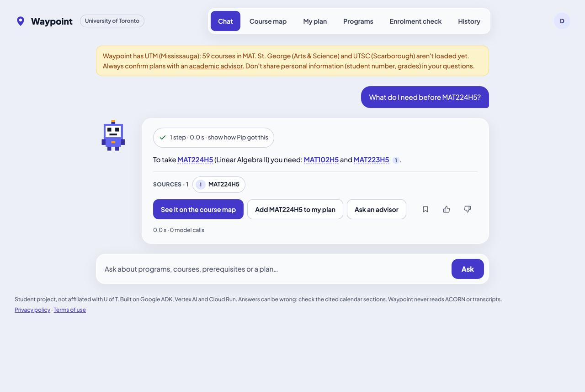
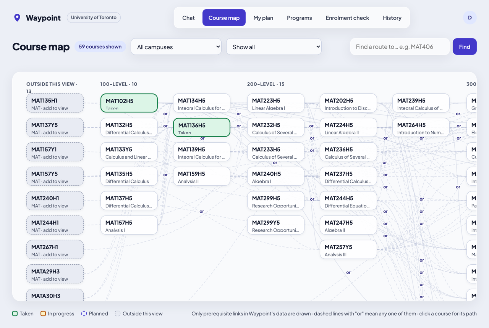
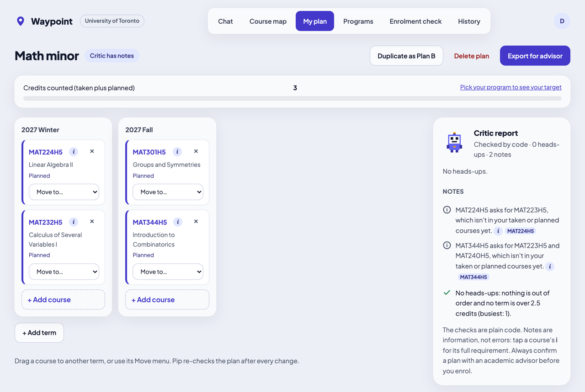
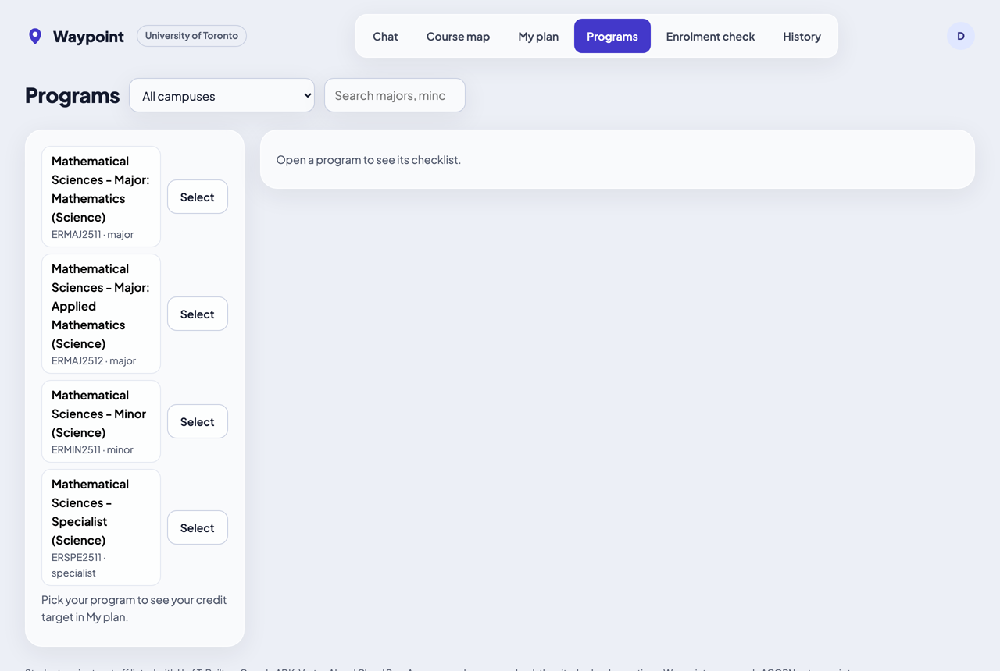
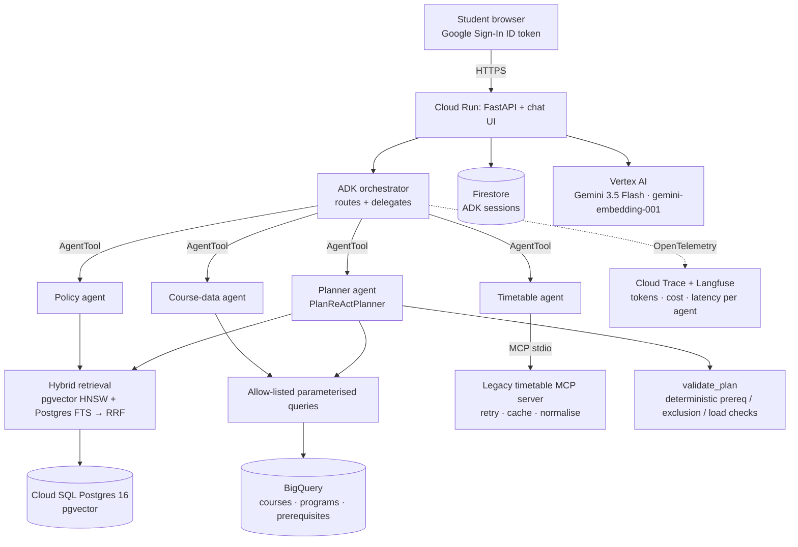

<p align="center"></p>

# Waypoint

Waypoint is a multi-agent degree-planning copilot for University of Toronto Mississauga students. Ask
*"What do I still need for the Math major, and what can I take next term?"* and an orchestrator agent on
Google ADK delegates to specialists. One reads the Academic Calendar through hybrid RAG on pgvector, one
queries course data in BigQuery, one reaches a legacy timetable through a custom MCP server, and a ReAct
planner builds a plan that deterministic code checks. Every factual claim cites the calendar passage it
came from, and every request is traced with tokens, cost and latency.

**Status: V3, live.** <https://waypoint-courses.web.app> (sign in with Google; Firebase Hosting in front of Cloud Run).
Hosting buffers streamed responses, so the page sends only the answer stream (`POST /api/chat/stream`) straight to the
Cloud Run URL, <https://waypoint-lirjy54bfa-uc.a.run.app>, with CORS limited to the two Hosting origins; everything
else goes through Hosting. Second deployment, a labelled demo built with fde-kit:
<https://fdekit-demo-48349810745.us-central1.run.app>. Users: [TBD].

What it knows today: **UTM Mathematical Sciences only** (59 MAT courses, 4 programs). The St. George and UTSC
adapters exist but hold no real data, because the U of T calendar sites return 403 to Waypoint's fetcher and it stops
there rather than working around it (see [Data sources](#data-sources)). Timetable data is **synthetic sample data**.

Known limits right now: plans cover only what the parsed data can check. A requirement line Waypoint can't read, or a
course outside the data (ISP100H5, STA and CSC courses), is listed for the student to handle, not planned. Waypoint
doesn't know which term a course is offered. Planning follow-ups that lean on earlier turns still go to the slower
agent planner (20 s limit).

<p align="center"></p>

| Chat: a fact answered from the parsed calendar, with its source | Course map: prerequisite links from the data, coloured by the student's courses |
|---|---|
|  |  |
| **My plan: terms, drag and drop, and a critic report computed by code** | **Programs: the four MAT programs, each with a checklist** |
|  |  |

Screenshots: Playwright against the app running locally with the real parsed calendar data and the offline model stub
(the chat answer is a fact-route answer, which uses no model).

## Architecture



## Metrics

From a real eval run (`evals/results/eval_v0.json`): a ragaudit-generated golden set over the calendar
corpus, split into dev/test by chunk, with Waypoint scored end to end on the **held-out test split**.

<!-- metrics:start -->
| Metric (eval_v0, held-out test split, n=21, k=5) | Value |
|---|---|
| Answer accuracy (LLM judge, Gemini 3.5 Flash) | 66.7% (14/21) |
| Retrieval hit rate (recall@5) | 81.0% |
| MRR | 0.750 |
| P50 / P95 latency (end to end, all agents) | 6.0 s / 16.0 s |
| Cost per query (model tokens, estimated) | $0.0112 |
| Mean model calls per query | 5.45 |
| Invalid citations reaching the answer | 0 |

Run on 2026-10-28 against live Vertex AI, Cloud SQL and BigQuery. One of the 21 questions failed with a Vertex AI
429 (quota) error and counts as a miss. Gemini 429s are now retried with backoff. The golden questions were
generated by ragaudit (flash-lite) and verified by a different model (flash), and 62 of 127 candidates were
rejected (ambiguous, too lexical, unanswerable, ...). Cost uses third-party price figures (see
`waypoint/observability/cost.py`).

### V2 Stage 1: speed (streaming, fast-path router, answer cache)

Same held-out test split (n=21, so roughly ±10 points of noise), real Gemini, three V2 runs plus the V1 path re-run
the same day. Details and caveats in the build log.

| | V1 eval_v0 (Oct 28) | V1 path, re-run (router off) | V2 run 1 | V2 run 2 | V2 run 3 |
|---|---|---|---|---|---|
| Answer accuracy | 66.7% | 57.1% | 47.6% | 57.1% | 52.4% |
| Recall@5 | 81.0% | 81.0% | 81.0% | 81.0% | 81.0% |
| TTFT P95 (V1: same as total) | 16.0 s | 14.7 s | 8.1 s | 33.4 s | 39.4 s |
| Total P95 | 16.0 s | 14.7 s | 8.1 s | 33.6 s | 39.5 s |
| Cost per question | $0.0112 | $0.0103 | $0.0047 | $0.0047 | $0.0050 |
| Mean model calls | 5.45 | 5.48 | 3.57 | 3.57 | 3.57 |

Cost and model calls dropped clearly. Accuracy is lower than the Oct 28 run, but the unchanged V1 path also scored
57.1% on re-run, so most of that gap looks like run-to-run drift; a small fast-path effect is not ruled out.
Latency was erratic during runs 2 and 3 (Vertex-side) and is not claimed as a win. Router eval (36 labelled
questions, live flash-lite): 97.2% route accuracy, 0 wrong fast routes; CI fails below 90%.
### V3: facts from data, policy RAG tuned with ragaudit

| | V2 (eval_v0 / Stage 1) | V3 |
|---|---|---|
| Fact accuracy (deterministic, 167 questions generated from the parsed tables) | n/a | 99.4% (1 miss) |
| Policy RAG, dev split (n=25; local qwen2.5:7b / llama3.1:8b) | n/a | 92.0% pass (answer accuracy 96%, recall@5 96%) |
| Policy RAG, locked test split (n=10), scored once | n/a | 90.0%; `ragaudit tune` found no better config, dev-test gap 2 pts |
| Agent eval, held-out test split (n=21, Gemini judge): accuracy / recall@5 | 66.7% / 81.0% | 61.9% / 71.4% |
| Total latency P95 (agent eval) | 16.0 s | 6.9 s |
| Cost per query (agent eval) | $0.0112 | $0.0039 |
| Fact-route latency | n/a | 1.6–2.0 s live, 0 model calls for the answer |

Caveats, stated plainly: the policy sets are small (10 test questions), so only large differences mean anything; the
agent-eval accuracy drop is inside the noise at n=21 and the corpus and questions changed between versions, so this is
not a controlled comparison. The 99.4% fact number checks Waypoint against tables it parsed itself, so it measures the
answering code, not whether the parser read the calendar correctly (51 of 59 prerequisite trees fully parsed; 8 keep an
unparsed piece).

### Planning speed (after launch)

10 planning questions (`evals/planning_questions.jsonl`), live on Vertex, answer cache off (`evals/plan_speed.py`):

| | Agent planner (V3 launch, 45 s limit) | Fast planner (now) |
|---|---|---|
| First content P50 / P95 | 16.2 s / 46.9 s | 0.05 s / 1.7 s |
| Total P50 / P95 | 16.2 s / 46.9 s | 1.8 s / 3.2 s |
| Valid plans / timeouts | 5/10 / 1 | 10/10 / 0 |
| Model calls (mean) / cost for all 10 | 9.5 / $0.68 | 1.1 / $0.005 |

After the deploy, the live smoke-test plans took 1.4–3.7 s end to end (the slower one on a cold instance). The agent
planner is a drafter + critic loop (up to 19 model calls) whose answer isn't streamed. The fast planner builds the plan
in code from the parsed requirements and prerequisites, checks it with the same validator the critic uses, sends it at
once, and then streams a 2–4 sentence explanation from Gemini 3.5 Flash-Lite (`evals/plan_speed.py`, live, cache off;
`evals/results/plan_speed_*.json`). Its 10/10 is judged by that same validator, so it shows the plans are consistent
with the data, not that an advisor would sign off on them. The "~7 tokens/s" reported at launch was Waypoint's own
tokens-per-second metric (all output over the whole multi-call request), not Gemini's speed: measured directly, Gemini
3.5 Flash with minimal thinking returns its first token in 1.3–1.8 s. Flash-Lite was kept for the explanation after it
matched Flash on a deterministic judge (9–10/10 in two runs each) at about a quarter of the cost
(`evals/plan_explainer_eval.py`).
<!-- metrics:end -->

## How it works

| Piece | Where | Notes |
|---|---|---|
| Ingestion | `waypoint/ingest/` | Parses cached calendar HTML into courses, programs and heading-based chunks with **stable ids** (`cal:<page>#<course-or-program-or-heading>`). Only changed chunks are re-embedded. |
| Vector DB | `waypoint/retrieval/store.py` | Cloud SQL Postgres 16 + pgvector 0.8: HNSW (cosine) index plus a generated `tsvector` column (GIN) that also indexes bare course codes. |
| Hybrid retrieval | `waypoint/retrieval/hybrid.py` | Vector top-20 + full-text top-20 merged with reciprocal rank fusion; top-5 to the agent. |
| Structured data | `waypoint/tools/catalog.py` | BigQuery tables; the model can only call 5 named, parameterised queries (50 MB billing cap each). |
| Legacy MCP | `waypoint/mcp/timetable/` | MCP server (`search_sections`, `find_sections`, `get_section`) wrapping a messy legacy format with retries, a TTL cache and schema normalisation. |
| Agents | `waypoint/agents/` | Orchestrator → specialists as `AgentTool`s (hierarchical delegation); planner uses `PlanReActPlanner` (ReAct). |
| Plan checks | `waypoint/tools/plan.py`, `prereqs.py` | Prerequisites, exclusions, duplicates and per-term load are checked by code, not by the model. |
| Citation guard | `waypoint/agents/runtime.py` | A cited chunk id must have been returned by a tool in the same request, or it's stripped. |
| Budgets | `RecorderPlugin` | Request-wide model-call cap across *all* agents, `max_output_tokens`, minimal thinking, per-user daily cap. |
| Observability | `waypoint/observability/` | OTel spans per agent/tool/LLM call; request span with tokens, cost, tokens/sec → Cloud Trace + Langfuse. See `docs/OBSERVABILITY.md`. |
| Auth | `waypoint/api/auth.py` | Google Identity Services ID token verified server-side; sessions keyed by Google `sub`. Fails closed if no client id is configured. |
| Evals | `evals/` | ragaudit golden set (dev/test split by chunk) + Waypoint adapter; P95 latency and cost per query from request metrics. |

## Data sources

- **UTM Academic Calendar** (`utm.calendar.utoronto.ca`), public pages only, fetched with an identifying user
  agent, a robots.txt check and a 2 s delay. The site began returning 403 to the bot client after the first
  fetches, so Waypoint did not keep fetching. The corpus is the Mathematical Sciences page fetched before
  that. Adding more pages takes three steps: save them to `data/raw/calendar/`, then run `ingest parse`,
  then `ingest pgvector`.
- **Timetable (demo only, not in the app):** since V3 the app has an Enrolment check tab instead of a timetable, and
  the orchestrator no longer calls the timetable agent. The public timetable's terms of use are unclear, so the MCP
  adapter, kept as an MCP demo, runs on a labelled **synthetic sample** (`waypoint/mcp/timetable/sample_data/`). Every result says so, and the agents are told
  to say so too.
- Waypoint never logs in to ACORN or any student system, and never reads transcripts.

## Running it

```bash
uv sync --all-groups                      # Python 3.12 via uv
uv run pytest                             # fully offline: mock LLM, mock embeddings, in-memory stores
uv run ruff check . && uv run mypy

# Local app on :8080, offline (mock LLM) and without sign-in:
WAYPOINT_DEV_SKIP_AUTH=true uv run uvicorn waypoint.api.app:app --port 8080

# Real models and data (needs gcloud ADC, cloud-sql-proxy on :5432, WAYPOINT_DB_PASSWORD exported):
WAYPOINT_LLM=vertex WAYPOINT_EMBEDDINGS=vertex WAYPOINT_STORE=pgvector WAYPOINT_CATALOG=bigquery \
  uv run python -m waypoint.agents "What are the prerequisites for MAT224?"
```

Ingestion: `uv run python -m waypoint.ingest {fetch|parse|pgvector|bigquery}`.
Deploy: `infra/bootstrap_iam.sh` (once), then `infra/deploy.sh`.
Evals: see `evals/run_eval.py`.

## More

| Topic | Where |
|---|---|
| Design doc (architecture, choices, risks) | [`docs/DESIGN.md`](docs/DESIGN.md) |
| Case study (problem → evals → what didn't work) | [`docs/CASE_STUDY.md`](docs/CASE_STUDY.md) |
| What's deferred, and why | [`docs/ROADMAP.md`](docs/ROADMAP.md) |
| Critic A/B, safety suite, CI eval gate | [`evals/README.md`](evals/README.md) |
| Conversation-state before/after (a negative result) | [`docs/STATE_OPTIMISATION.md`](docs/STATE_OPTIMISATION.md) |
| Runbook (deploy, rollback, budgets, alerts) | [`docs/RUNBOOK.md`](docs/RUNBOOK.md) |
| Waypoint as an MCP server | [`waypoint/mcp/waypoint/`](waypoint/mcp/waypoint/) |
| MCP Toolbox config for BigQuery | [`infra/toolbox/`](infra/toolbox/) |
| Terraform (validated and planned, not applied) | [`infra/terraform/`](infra/terraform/) |
| fde-kit, the reusable pieces as a package | [`fde-kit/`](fde-kit/) |
| Second deployment built with fde-kit (demo, Parks Canada open data) | [`fdekit-demo/`](fdekit-demo/) |
| Upstream ADK issue drafts with repros (not filed) | [`docs/upstream-issues/`](docs/upstream-issues/) |

## Security

- No secrets in the repo. The DB password and Langfuse keys come from Secret Manager, mounted by Cloud Run.
- Least-privilege runtime service account (`infra/bootstrap_iam.sh`).
- Per-user session isolation: sessions are keyed by the Google `sub` claim, so another user's session id
  creates a new session instead of opening theirs.
- Retrieved text is fenced and labelled as data, and the prompts tell agents to ignore instructions in it.
  Citations are validated against what was actually retrieved.
- The model never writes SQL.
- Students' messages aren't written to traces, which carry only metrics and a salted user hash.
