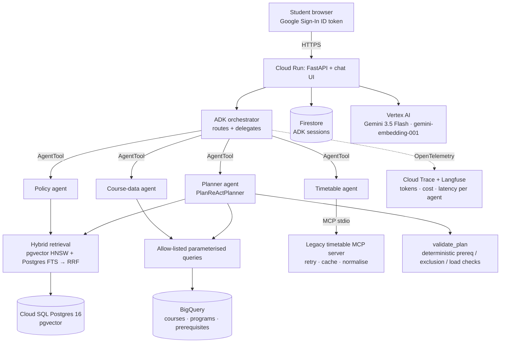

# Waypoint

Waypoint is a multi-agent degree-planning copilot for University of Toronto Mississauga students. Ask
*"What do I still need for the Math major, and what can I take next term?"* and an orchestrator agent on
Google ADK delegates to specialists. One reads the Academic Calendar through hybrid RAG on pgvector, one
queries course data in BigQuery, one reaches a legacy timetable through a custom MCP server, and a ReAct
planner builds a plan that deterministic code checks. Every factual claim cites the calendar passage it
came from, and every request is traced with tokens, cost and latency.

**Status: v0.3 (Phase 3: built and evaluated, not deployed yet).** Live URL: [TBD after deploy]. Users:
[TBD]. The calendar corpus currently covers
the Mathematical Sciences section (4 programs, 59 MAT courses). Timetable data is **synthetic sample data**
(see [Data sources](#data-sources)).

## Architecture



## Metrics

From a real eval run (`evals/results/eval_v0.json`): a ragaudit-generated golden set over the calendar
corpus, split into dev/test by chunk, with Waypoint scored end to end on the **held-out test split**.

<!-- metrics:start -->
| Metric (eval_v0, held-out test split, n=21, k=5) | Value |
|---|---|
| Answer accuracy (LLM judge, Gemini 3.5 Flash) | 66.7% (14/21) |
| Retrieval hit rate (recall@5) | 81.0% |
| MRR | 0.750 |
| P50 / P95 latency (end to end, all agents) | 6.0 s / 16.0 s |
| Cost per query (model tokens, estimated) | $0.0112 |
| Mean model calls per query | 5.45 |
| Invalid citations reaching the answer | 0 |

Run on 2026-10-28 against live Vertex AI, Cloud SQL and BigQuery. One of the 21 questions failed with a Vertex AI
429 (quota) error and counts as a miss. Gemini 429s are now retried with backoff. The golden questions were
generated by ragaudit (flash-lite) and verified by a different model (flash), and 62 of 127 candidates were
rejected (ambiguous, too lexical, unanswerable, ...). Cost uses third-party price figures (see
`waypoint/observability/cost.py`).
<!-- metrics:end -->

## How it works

| Piece | Where | Notes |
|---|---|---|
| Ingestion | `waypoint/ingest/` | Parses cached calendar HTML into courses, programs and heading-based chunks with **stable ids** (`cal:<page>#<course-or-program-or-heading>`). Only changed chunks are re-embedded. |
| Vector DB | `waypoint/retrieval/store.py` | Cloud SQL Postgres 16 + pgvector 0.8: HNSW (cosine) index plus a generated `tsvector` column (GIN) that also indexes bare course codes. |
| Hybrid retrieval | `waypoint/retrieval/hybrid.py` | Vector top-20 + full-text top-20 merged with reciprocal rank fusion; top-5 to the agent. |
| Structured data | `waypoint/tools/catalog.py` | BigQuery tables; the model can only call 5 named, parameterised queries (50 MB billing cap each). |
| Legacy MCP | `waypoint/mcp/timetable/` | MCP server (`search_sections`, `find_sections`, `get_section`) wrapping a messy legacy format with retries, a TTL cache and schema normalisation. |
| Agents | `waypoint/agents/` | Orchestrator → specialists as `AgentTool`s (hierarchical delegation); planner uses `PlanReActPlanner` (ReAct). |
| Plan checks | `waypoint/tools/plan.py`, `prereqs.py` | Prerequisites, exclusions, duplicates and per-term load are checked by code, not by the model. |
| Citation guard | `waypoint/agents/runtime.py` | A cited chunk id must have been returned by a tool in the same request, or it's stripped. |
| Budgets | `RecorderPlugin` | Request-wide model-call cap across *all* agents, `max_output_tokens`, minimal thinking, per-user daily cap. |
| Observability | `waypoint/observability/` | OTel spans per agent/tool/LLM call; request span with tokens, cost, tokens/sec → Cloud Trace + Langfuse. See `docs/OBSERVABILITY.md`. |
| Auth | `waypoint/api/auth.py` | Google Identity Services ID token verified server-side; sessions keyed by Google `sub`. Fails closed if no client id is configured. |
| Evals | `evals/` | ragaudit golden set (dev/test split by chunk) + Waypoint adapter; P95 latency and cost per query from request metrics. |

## Data sources

- **UTM Academic Calendar** (`utm.calendar.utoronto.ca`), public pages only, fetched with an identifying user
  agent, a robots.txt check and a 2 s delay. The site began returning 403 to the bot client after the first
  fetches, so Waypoint did not keep fetching. The corpus is the Mathematical Sciences page fetched before
  that. Adding more pages takes three steps: save them to `data/raw/calendar/`, then run `ingest parse`,
  then `ingest pgvector`.
- **Timetable:** the public timetable's terms of use are unclear, so the MCP adapter runs on a labelled
  **synthetic sample** (`waypoint/mcp/timetable/sample_data/`). Every result says so, and the agents are told
  to say so too.
- Waypoint never logs in to ACORN or any student system, and never reads transcripts.

## Running it

```bash
uv sync --all-groups                      # Python 3.12 via uv
uv run pytest                             # fully offline: mock LLM, mock embeddings, in-memory stores
uv run ruff check . && uv run mypy

# Local app on :8080, offline (mock LLM) and without sign-in:
WAYPOINT_DEV_SKIP_AUTH=true uv run uvicorn waypoint.api.app:app --port 8080

# Real models and data (needs gcloud ADC, cloud-sql-proxy on :5432, WAYPOINT_DB_PASSWORD exported):
WAYPOINT_LLM=vertex WAYPOINT_EMBEDDINGS=vertex WAYPOINT_STORE=pgvector WAYPOINT_CATALOG=bigquery \
  uv run python -m waypoint.agents "What are the prerequisites for MAT224?"
```

Ingestion: `uv run python -m waypoint.ingest {fetch|parse|pgvector|bigquery}`.
Deploy: `infra/bootstrap_iam.sh` (once), then `infra/deploy.sh`.
Evals: see `evals/run_eval.py`.

## More

| Topic | Where |
|---|---|
| Design doc (architecture, choices, risks) | [`docs/DESIGN.md`](docs/DESIGN.md) |
| Case study (problem → evals → what didn't work) | [`docs/CASE_STUDY.md`](docs/CASE_STUDY.md) |
| What's deferred, and why | [`docs/ROADMAP.md`](docs/ROADMAP.md) |
| Critic A/B, safety suite, CI eval gate | [`evals/README.md`](evals/README.md) |
| Conversation-state before/after (a negative result) | [`docs/STATE_OPTIMISATION.md`](docs/STATE_OPTIMISATION.md) |
| Runbook (deploy, rollback, budgets, alerts) | [`docs/RUNBOOK.md`](docs/RUNBOOK.md) |
| Waypoint as an MCP server | [`waypoint/mcp/waypoint/`](waypoint/mcp/waypoint/) |
| MCP Toolbox config for BigQuery | [`infra/toolbox/`](infra/toolbox/) |
| Terraform (validated and planned, not applied) | [`infra/terraform/`](infra/terraform/) |
| fde-kit, the reusable pieces as a package | [`fde-kit/`](fde-kit/) |
| Second deployment built with fde-kit (demo, Parks Canada open data) | [`fdekit-demo/`](fdekit-demo/) |
| Upstream ADK issue drafts with repros (not filed) | [`docs/upstream-issues/`](docs/upstream-issues/) |

## Security

- No secrets in the repo. The DB password and Langfuse keys come from Secret Manager, mounted by Cloud Run.
- Least-privilege runtime service account (`infra/bootstrap_iam.sh`).
- Per-user session isolation: sessions are keyed by the Google `sub` claim, so another user's session id
  creates a new session instead of opening theirs.
- Retrieved text is fenced and labelled as data, and the prompts tell agents to ignore instructions in it.
  Citations are validated against what was actually retrieved.
- The model never writes SQL.
- Students' messages aren't written to traces, which carry only metrics and a salted user hash.
