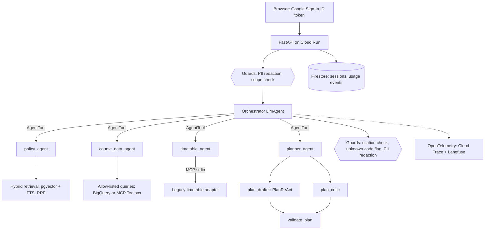

# Waypoint design

Status: v0.2 (Phase 2). Owner: Ali Ismail. Last updated 2026-10-28.

## Problem

UTM students plan their degrees from the Academic Calendar: long pages of program requirements, prerequisite
chains and policy text. They also check a separate timetable. Advising appointments are limited, and the
common questions ("what do I still need?", "can I take X next term?") take only a few lookups to answer. They
are easy to get wrong when done by hand.

Waypoint answers those questions in plain language and cites the calendar passage behind every factual
claim. It drafts term-by-term plans that code has checked. It always points to an advisor for the final word.

## Goals and non-goals

Goals:
- Correct, cited answers about programs, courses, prerequisites and policy, for the programs the data covers.
- Plans whose prerequisites, exclusions and course loads are checked by deterministic code, not the model.
- Measured quality (held-out eval set), cost per question, P95 latency, and safety, all gated in CI.
- Cheap to run: scales to zero, with a per-request model-call budget and a per-user daily cap.

Non-goals:
- No access to student records. Waypoint never logs in to ACORN or reads transcripts or grades.
- No enrolment actions. Waypoint only gives advice.
- No full-calendar coverage yet. v0 covers the Mathematical Sciences section (see Data).

## Architecture

| Piece | Choice | Why | Alternatives considered |
|---|---|---|---|
| Agent framework | Google ADK, with specialists as `AgentTool`s | Hierarchical delegation: the orchestrator keeps control and composes one answer | `sub_agents` transfer: the orchestrator loses the turn and can't combine answers |
| Model | Gemini 3.5 Flash, `thinking_level=minimal` | In a live A/B, minimal used 7 model calls and `low` used 16 on the same plan question. Latency is about 2 s per sequential call | Pro: slower and costlier, with no measured accuracy need yet |
| Retrieval | pgvector HNSW (cosine) + Postgres full-text, fused with RRF (k=60), top 5 | Course codes are exact tokens that vectors blur; full text catches them | Vector only: misses codes. Vertex Ranking API: not enabled, and not needed for v0 |
| Structured data | BigQuery behind 5 named, parameterised queries | The model never writes SQL. A 50 MB billing cap per query | Free-form text-to-SQL: injection and cost risk |
| Toolbox | `infra/toolbox/tools.yaml`, generated from the same allow-list | One source of truth. Toolbox holds BigQuery credentials, read-only, dataset-scoped | Hand-written tools.yaml: drifts from the code |
| Timetable | Custom MCP server around a legacy adapter (retry, TTL cache, normalisation) | The real source's terms are unclear, so it runs on labelled synthetic data and can be swapped later | Scraping the live timetable: terms of use unclear |
| Plans | ReAct drafter + critic, at most 2 revisions, deterministic veto | A plan that fails `check_plan` can never be approved, whatever the critic says | LoopAgent: the stopping rule is implicit and harder to test |
| Sessions | Firestore (ADK `FirestoreSessionService`), keyed by Google `sub` | Serverless, scales to zero, per-user isolation | Cloud SQL sessions: one more schema to run |
| Auth | Google Identity Services ID token, verified server-side with google-auth | No redirect flow, and no tokens stored server-side | OAuth code flow: needs redirect URIs and token storage |

## Data

- **Calendar:** public pages from `utm.calendar.utoronto.ca`, fetched with an identifying user agent, a
  robots.txt check and a 2 s delay. The site began returning 403 to the bot client after the first pages,
  so fetching stopped. The corpus is the Mathematical Sciences section: 72 chunks, 59 courses and 4 programs.
  Every chunk has a stable id (`cal:<page>#<anchor>`), and only chunks whose content hash changed are
  re-embedded.
- **Timetable:** synthetic sample data, labelled in every tool result. The agents are told to say so.
- **Students:** only what they type. PII is redacted before it reaches the model, the session store or traces.

## Request flow and budgets

1. Verify the ID token, then check the per-user daily cap (30 questions).
2. Redact PII. A scope pre-filter declines obvious off-topic requests (essays, homework) without a model call.
3. The orchestrator delegates. There is a request-wide budget of 24 model calls, counted across every agent.
   ADK's `RunConfig.max_llm_calls` counts each `AgentTool` child separately, and one request once made 87 calls.
4. Output guards: citations must point at chunks retrieved in the same request (others are stripped). Course
   codes no tool returned are flagged. PII is redacted again.
5. Record a usage event (hashed user, ids and numbers, no text) and log one structured metrics line.

## Conversation state

Only the orchestrator sees conversation history, because each specialist starts fresh for every call.
History is append-only, so Gemini's implicit prefix cache can reuse it. Once the orchestrator's prompt
passes 30k tokens, ADK events compaction summarises older turns. The summariser's tokens are metered,
because plugins don't see that call. Pruning earlier specialist outputs is implemented but off: in a live
before/after it cut the orchestrator's context by 34% but raised cost per conversation by 31%, because it
broke the implicit cache (`docs/STATE_OPTIMISATION.md`). Explicit `ContextCacheConfig` is off: it creates a
billed CachedContent resource and needs a 4096-token prefix on Gemini 3.

## Quality, safety and cost

- **Evals:** a ragaudit golden set generated from the corpus, with a different model verifying, split
  dev/test by chunk. Results are in `evals/results/` and the README.
- **Safety suite** (`evals/safety_suite.py`) covers injection hidden in retrieved text, PII echo,
  out-of-scope requests and hallucinated course codes. Guard checks run offline in CI. Model-behaviour
  checks run live.
- **CI gate** (`.github/workflows/ci.yml`) runs offline, with no secrets. It fails on a drop of more than
  3 points in accuracy, a rise of more than 20% in P95 latency or model calls versus the base branch, or any
  safety failure.
- **Cost** is computed from token usage with a price table (third-party figures, `observability/cost.py`).
  It is reported per request, per agent span and per eval run.

## Observability

OpenTelemetry spans cover each agent, tool and model call. A `waypoint.request` root span carries tokens,
cost, tokens/sec, cache hit rate and tool errors. Spans go to Cloud Trace and Langfuse. Message content is
never put in spans. The Cloud Monitoring dashboard (Terraform, `infra/terraform/monitoring.tf`) charts the
same fields from the structured request log. See `docs/OBSERVABILITY.md`.

## Risks

| Risk | Mitigation |
|---|---|
| Wrong requirement or prerequisite advice | Citations to retrieved passages; deterministic plan checks; "confirm with an advisor" on every plan; advisor link on every answer |
| Prompt injection via retrieved text | Fenced, labelled passages (fence markers neutralised); citation guard; safety suite with poisoned passages |
| Runaway cost | Request-wide call budget, minimal thinking, per-user daily cap, max 2 instances, budget alert (Terraform) |
| Calendar changes yearly | Content-hash re-embedding; stable chunk ids; the golden set is re-generated per calendar version |
| Gemini quota (429) | HTTP retry with backoff on 429/503 |
| Malformed model turns | `RetryingGemini` retries `MALFORMED_RESPONSE` up to twice |

## Open questions

- Coverage beyond Mathematical Sciences depends on getting calendar pages without tripping bot protection
  (manual export or an official feed).
- A real timetable feed, under clear terms.
- Whether a reranker improves the 81% recall@5 enough to justify its latency.
